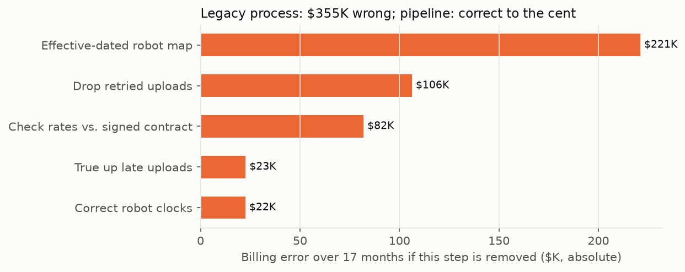
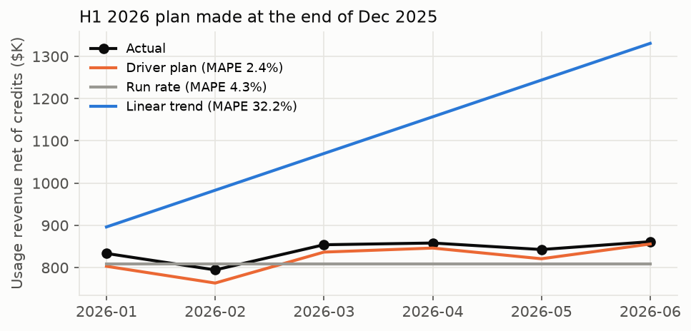
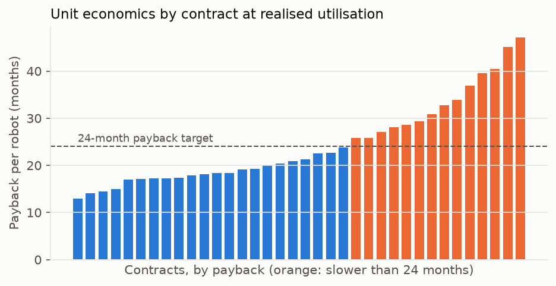

# Robot-as-a-Service Finance OS — Usage Billing, Close Automation and Fleet Economics in Code

A robot-labor company charges customers for each productive hour its robots work, with:
- **minimum commitments,**
- **tiered rates,**
- **downtime credits,**
- **one-time deployment fees.**

Its billing, revenue and unit economics all depend on what the robots actually did. This lab builds the finance
systems for such a company in Python and SQL, and checks every number against a simulation where the truth is
known:

- **Usage-to-invoice pipeline:** raw robot events → invoices that reconcile to real usage. It handles retried
  uploads, robot clock skew, late uploads, robots moved between customers, and billing-system typos.
- **Close automation:**
  - an append-only, hash-chained double-entry ledger with idempotency keys and maker-checker approvals;
  - cash application;
  - spend review (duplicates, miscoding, split purchases);
  - tie-outs: AR subledger, deferred revenue, billing to revenue, bank to GL.
- **Plan and variance:** a driver-based revenue plan built bottom-up per customer, backtested against naive
  forecasts.
  - **Exact variance split:** budget-vs-actual divided into fleet, utilisation, rate and credit effects that add
    up exactly.
  - **Commentary:** written by a template or by Claude. Either way, every number is checked against the ledger
    facts before it can be used.
- **Fleet economics:** per-robot cash flows, payback, IRR and NPV; equipment financing; sensitivity; per-contract
  economics at actual utilisation; and the minimum commitment a deal needs.
- **Finance data layer:** DuckDB joining CRM, contracts, robot operations, billing, ledger, spend and cash.
- **FastAPI service** and a self-contained **[close dashboard](docs/close_dashboard.html)**.

> **Simulated company, known truth.** The company has 36 customers and 147 robots over 18 months (2025-01 to
> 2026-06), with $10.9M billed. It is generic, not modelled on any real company's data. Every error source is
> planted and counted, which is what makes "correct to the cent" checkable. Cost assumptions (robot build cost,
> maintenance, remote operations) are placeholders.

## 1. Usage-to-invoice

**What the raw data does wrong:** 56,416 raw robot events. Of these:
- 834 are retried uploads;
- 36 robots have clocks off by 4–11 hours;
- 19 robots have flaky connections and upload days late;
- 7 robots were moved to another customer mid-contract;
- 3 contracts were keyed wrongly into the billing system: a 10% lower rate, a tier with no discount, and a dropped
  minimum.



Results on 375 customer-months of invoices (the last month is excluded because its late uploads are trued up
after the simulation ends):

| | Legacy process | Pipeline |
|---|---|---|
| Invoices correct (within $1) | 28.5% | **100% after true-ups** (76.5% on the first invoice; the rest arrive as disclosed prior-period adjustments) |
| Over-billed | $192K | $0.01 |
| Under-billed | $163K | $0.01 |
| Absolute error | **$355K (3.6% of billings)** | **2 cents (rounding)** |
| Largest single invoice error | $12.4K | $0.01 |
| Robot-days billed for more than 24 hours | 410 | 2 (flagged for review) |

**How the pipeline works:**
- **Drop retried uploads** (same robot and sequence number).
- **Correct robot clocks** using the fleet's measured clock offsets.
- **Attribute usage by effective date:** to the customer the robot worked for *at that time*, not today's map.
- **True up late uploads:** re-rate the service month and bill the difference as a prior-period adjustment,
  instead of losing it (88 adjustments, $22.6K).
- **Check billing configuration:** compare every contract in the billing system with the signed terms in the
  CRM before rating. This caught all 3 typos.

**What each step is worth** (absolute billing error if that step alone is removed):
- effective-dated robot map: $221K;
- dropping retries: $106K;
- configuration check: $82K;
- late true-ups: $23K (only ever *under*-billing);
- clock correction: $22K.

**The 2 remaining exceptions are real edge cases.** A clock correction accurate to ±6 minutes moved a
just-before-midnight session onto the next day, so that robot-day shows more than 24 hours. Both are in the
same month, so the invoice is still right, but the control flags them for a person to confirm.

## 2. The close

**Volumes over 18 months:** 2,495 journals (5,089 ledger lines), 411 invoices, 858 vendor bills and 337 bank
deposits.

| Tie-out | Result |
|---|---|
| Trial balance balances | pass ($55.9M debits = credits) |
| Ledger hash chain intact | pass; editing any past line breaks verification (tested) |
| AR subledger = GL accounts receivable | pass ($2,175,170.36) |
| Deferred revenue schedule = GL | pass (deployment fees recognised over each contract's term) |
| Billing = usage revenue net of SLA credits | pass |
| GL cash = bank statement | pass |

- **Ledger controls (tested):**
  - unbalanced journals are rejected;
  - re-posting the same idempotency key returns the original journal, never a duplicate;
  - a manual journal of $25K or more is rejected unless someone other than the preparer approves it.
- **Cash application:** 311 of 317 customer payments auto-applied (98%). One was misapplied: a payment with no
  reference matched two identical $63,449.10 invoices from the same customer, and went to the older one instead
  of the newer one it was meant for. Same customer, wrong month; no cash was ever applied across customers
  (tested). The other 6 go to a review queue, along with 20 non-customer deposits.
  - payments with no reference: 88% applied;
  - one payment for two invoices: 85%;
  - short payments of bank fees: 100%.
- **Spend review:**
  - **Split purchases:** 24 of 24 caught (bills split to stay under the $10K approval limit), 5 false flags.
  - **Miscoded bills:** 30 of 30 caught, 19 false flags. These are legitimately unusual coding, such as field
    technicians' travel booked as cost of service.
  - **Duplicate bills:** 19 of 25 caught, 0 false flags. All monthly subscriptions were correctly left alone.
    The 6 misses were re-issued with a new invoice number more than 10 days later, so the rule is a review aid,
    not a guarantee.

## 3. Plan and variance



**How the plan is built,** bottom-up per customer:
- **Robots:** live robots, plus signed go-lives from the CRM.
- **Hours per robot:** each customer's recent hours per robot per weekday, times a ramp curve learned from
  history (a new robot runs at 59% of its mature level in its first month).
- **Weekdays** in each month.
- **Contract terms:** minimums and tiers.
- **SLA credits:** the historical credit rate.

**Backtest:** plans made at six month-ends (2025-07 to 2025-12), six months ahead each.

| Forecast | Mean absolute % error |
|---|---|
| **Driver plan** | **6.2%** (2.4% from the Dec-2025 origin) |
| Linear trend on the last 6 months | 19.0% |
| Run rate (last month flat) | 25.5% |

**Variance, H1 2026.** The Dec-2025 plan is the budget, and each month's variance is split exactly into four
effects. In January, revenue came in $30.4K above plan:
- **fleet −$27.3K:** sales had promised two go-lives in January that went live in February;
- **utilisation +$85.5K:** hours per robot were higher than planned;
- **rate −$32.0K:** more hours fell into discounted tiers;
- **credits +$4.2K.**

**Commentary is checked, not trusted.** Each month's commentary is written by a template or by Claude
(`--llm`). Before it can enter the close package:
- every number in it must match a computed fact;
- driver amounts must equal the decomposition;
- drivers must add up to the variance.

A Claude draft that fails gets one retry with the problems listed, then falls back to the template. With a fake
client, the tests check that an invented "+7.5%" or a changed driver amount is rejected. **Claude has not been
run on this yet:** run `python -m finos.study --llm` with your own API key (6 short calls on Haiku).

## 4. Fleet economics



**Base robot:** $75K build cost, $12K install, $6K deployment fee, $25/hour × 220 billed hours a month, $2K a
month for maintenance and remote operations, 48-month life.

| | Unfinanced | 80% equipment loan (9.5%, 36 months) |
|---|---|---|
| Cash up front | $81K | $21K |
| Payback | 23.1 months | 13.3 months |
| IRR | 53% | — (equity) |

- **Utilisation matters most.** ±20% billed hours moves payback from 17.6 to 33.8 months. A ±10% rate moves it
  from 20.0 to 27.5; ±15% build cost from 19.9 to 26.4.
- **A robot needs 215 billed hours a month to pay back in 24 months** (170 for 36 months).
- **Every contract's minimum commitment is below that.** Minimums range from 112 to 190 hours per robot, vs.
  192–259 hours needed at each contract's own realised rate. At actual utilisation, 14 of 36 contracts pay back
  slower than 24 months (range 13–47). This is the deal-desk finding: minimums are set for the customer's comfort,
  not the robot's payback.
- **Fleet plan:** deploying 330 robots over 24 months needs $16.9M of peak cash unfinanced, vs. $2.6M with 80%
  equipment financing.

## Run it

```powershell
python -m venv .venv; .venv\Scripts\activate
pip install -r requirements.txt
pytest -q                                  # 12 tests (~20 s)
python -m finos.study                      # results/results.json + results/finance.duckdb (~20 s)
python -m finos.report                     # results/*.png + docs/close_dashboard.html
uvicorn finos.service:app                  # http://localhost:8000/docs

# Optional: Claude writes the variance commentary (checked against the ledger); a few cents on Haiku
$env:ANTHROPIC_API_KEY = "sk-ant-..."      # set it in your shell only; never commit it
python -m finos.study --llm                # results/results_llm.json
```

## Layout
```
finos/
  sim.py         customers, contracts, robots, deployments, event stream with planted errors, CRM pipeline
  billing.py     rating (minimums, tiers, SLA credits, deployment fees), the pipeline and its five steps, evaluation
  ledger.py      double-entry ledger: balance check, idempotency keys, hash chain, maker-checker approvals
  close.py       invoices -> ledger, customer payments + cash application, vendor bills + spend review, tie-outs
  forecast.py    ramp curve, per-customer driver plan, naive forecasts, backtests
  variance.py    exact driver decomposition, template and Claude commentary, the number check
  economics.py   per-robot cash flows, payback, IRR, NPV, financing, sensitivity, fleet cash need
  datalayer.py   DuckDB tables and views (revenue by month, unit economics by customer, AR aging, trial balance)
  service.py     FastAPI
  study.py, report.py
tests/           12 tests
```

## Limits
- **Simulated data and placeholder costs.** The method transfers; the dollar figures don't.
- **Revenue recognition is simplified.** Usage is recognised in the service month; late true-ups are recognised
  when billed (a change in estimate); deployment fees are recognised ratably over the contract term. A real
  ASC 606 memo would cover variable consideration and minimum-commitment shortfalls more carefully.
- **No accounting system connected.** There is no NetSuite, QuickBooks or Ramp. The ledger stands in for the
  general ledger, and the API is where those integrations would plug in.
- **The dashboard is a static snapshot,** generated from `results.json`, not a live BI tool.
